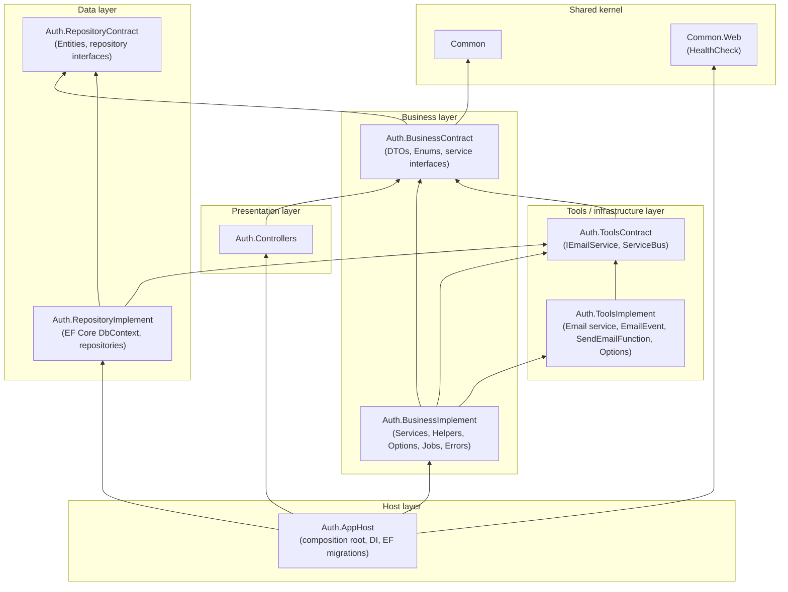
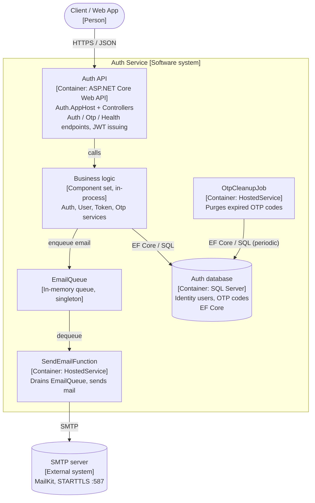

# Auth Service – Architecture Diagrams

Derived from the `*.csproj` references and `DependencyInjection.cs` in `source/TTECH.Backend/Auth`.

## 1. Package Diagram (compile-time project references, grouped by layer)

Arrow = "references" (A --> B means A depends on B).

Observations:

- Contract/Implement split holds for Business and Repository: Controllers depend only on `BusinessContract`.
- `AppHost` is the only project that references implementations and wires them via DI.
- `BusinessImplement -> ToolsImplement` is a direct implementation reference, which bypasses the contract and breaks the inversion. `ToolsContract -> BusinessContract` also makes the contract layers circular in intent. Worth reviewing.

## 2. C4 Container Diagram (runtime view)

Auth runs as one deployable ASP.NET Core process. The containers below are the runtime units, and the in-process hosted services are shown separately because they run on background threads.

Configuration sources (`appsettings.json`): `ConnectionStrings:Database`, `JWT`, `Otp` (`OtpOptions`), `Email` (`EmailOptions`).
