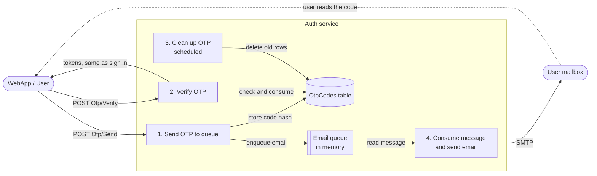
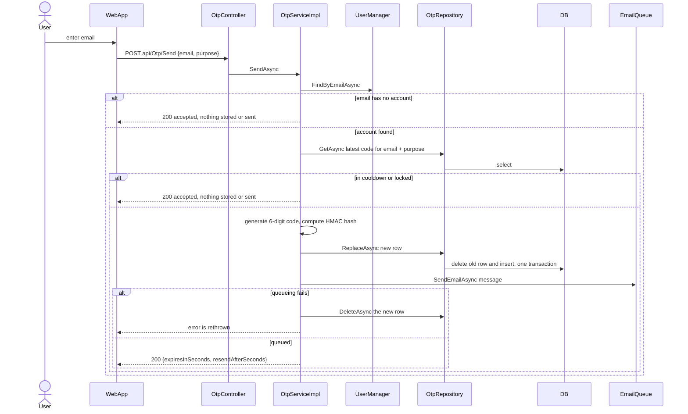
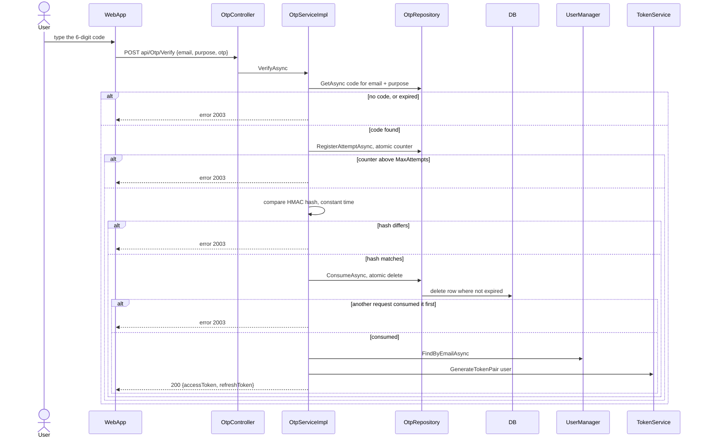
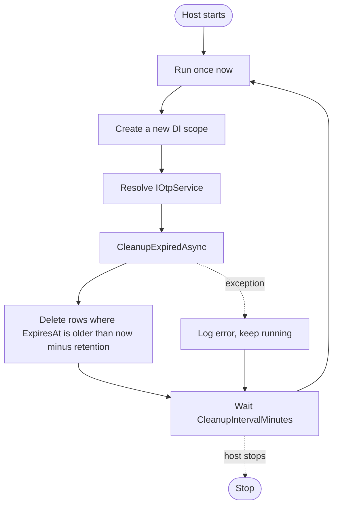
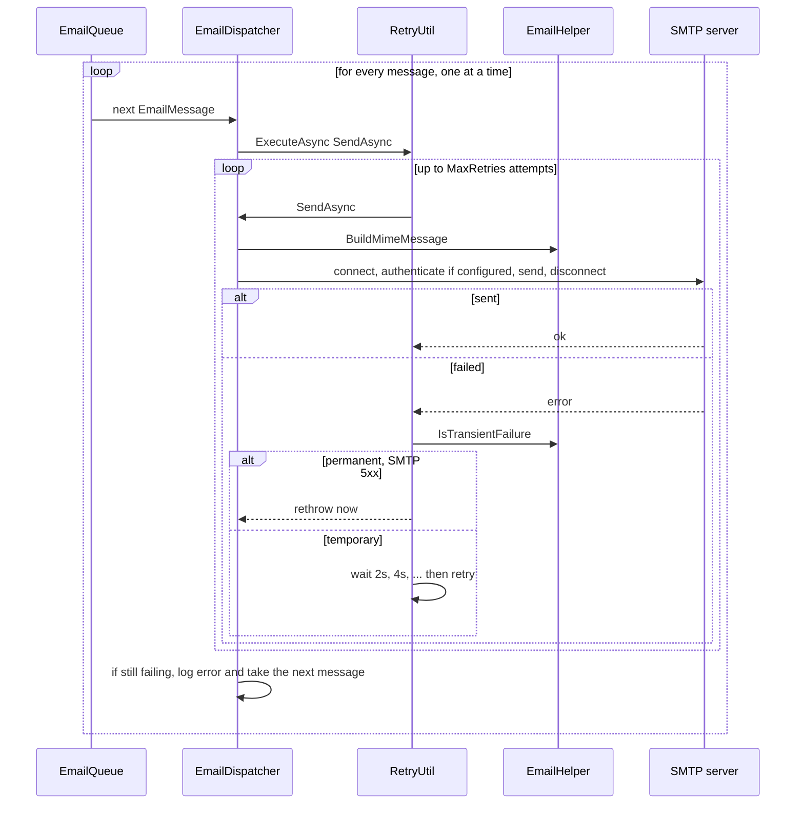
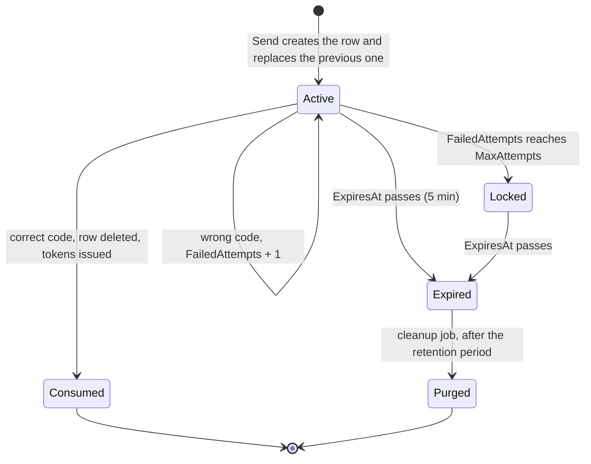
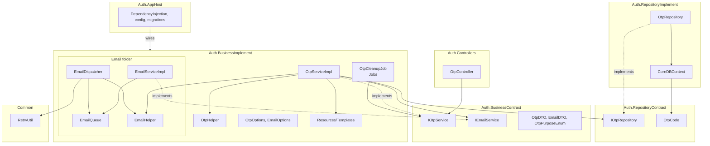

# OTP-Email design (Auth service)

Email OTP lets a user prove control of an email address and sign in with a one-time code. It is built to be reused by many targets through a `purpose` (today: `PasswordReset`).

This document goes **from feature to detail**: what the system does (section 1), how each of the four features works (sections 2 to 5), then the shared design behind them (section 6) and the rules and limits (section 7).

Source root: [`source/TTECH.Backend/Auth`](../../../source/TTECH.Backend/Auth)

---

## 1. Overview

### 1.1 The four features

| # | Feature | Trigger | Result |
|---|---|---|---|
| 1 | **Send OTP to queue** | `POST api/Otp/Send` | A code is stored (hash only) and an email is put on the email queue |
| 2 | **Verify OTP** | `POST api/Otp/Verify` | The code is checked and consumed, and the user gets sign-in tokens |
| 3 | **Clean up OTP** | Schedule (startup, then hourly) | Old OTP records are deleted |
| 4 | **Consume OTP message to send email** | Message arrives on the queue | The email is delivered over SMTP with retry |

### 1.2 How they connect

### 1.3 End-to-end story (password reset)

1. The user clicks "forgot password" and enters an email. The WebApp calls **Send**.
2. The user receives an email with a 6-digit code and types it in. The WebApp calls **Verify**.
3. Verify treats the code as an authentication method. It returns the same `TokensResponse` as sign in, so the user is **signed in**.
4. The WebApp then shows a popup that recommends changing the password immediately. This client step is outside the backend.

Verify is a sign-in, so the Auth service does not store or interpret tokens for OTP. It calls the existing token service.

---

## 2. Feature 1: Send OTP to queue

### 2.1 Purpose
Generate a one-time code for an email address and a purpose, store it safely, and queue the email that delivers it. The caller never waits for SMTP.

### 2.2 Flow

### 2.3 Rules

| Rule | Behavior |
|---|---|
| No account enumeration | Unknown email, cooldown and lock all return the **same** success response, and nothing is sent. |
| Resend cooldown | A new code is not issued within `ResendCooldownSeconds` (60) of the latest code. |
| Lock after failures | If the latest code has `FailedAttempts >= MaxAttempts` and has not expired, no new code is issued until it expires. |
| One active code | A new code replaces the previous one for the same email and purpose. |
| Code storage | The plain code is never stored or logged. Only an HMAC hash is stored. |
| Rollback | If the email cannot be queued, the stored code is deleted so the user is not left with a code they cannot receive. |
| Purpose | The email wording and template come from the purpose (see 6.5). An undefined purpose throws. |

### 2.4 Contract

| | |
|---|---|
| Request | `POST api/Otp/Send` with `{ "email": "...", "purpose": "PasswordReset" }` |
| Validation | Email is required, a valid address, at most 256 characters. Purpose must be a defined value. Failures return HTTP 400. |
| Response | `{ success, result: { expiresInSeconds, resendAfterSeconds }, error }` |

### 2.5 Implementation

| Part | Where |
|---|---|
| Endpoint | [`OtpController.Send`](../../../source/TTECH.Backend/Auth/Auth.Controllers/Controllers/OtpController.cs) |
| Logic | [`OtpServiceImpl.SendAsync`](../../../source/TTECH.Backend/Auth/Auth.BusinessImplement/Service/OtpServiceImpl.cs): `IsThrottled`, `DescribePurpose` and `BuildEmail` hold the business rules |
| Low-level tools | [`OtpHelper`](../../../source/TTECH.Backend/Auth/Auth.BusinessImplement/Helper/OtpHelper.cs) (normalize, generate, hash) and [`EmailHelper.RenderTemplate`](../../../source/TTECH.Backend/Auth/Auth.BusinessImplement/Email/EmailHelper.cs) |
| Storage | [`OtpRepository`](../../../source/TTECH.Backend/Auth/Auth.RepositoryImplement/Repository/OtpRepository.cs): `GetAsync`, `ReplaceAsync`, `DeleteAsync` |
| Queue entry | [`EmailServiceImpl`](../../../source/TTECH.Backend/Auth/Auth.BusinessImplement/Email/EmailServiceImpl.cs) writes to [`EmailQueue`](../../../source/TTECH.Backend/Auth/Auth.BusinessImplement/Email/EmailQueue.cs) |

---

## 3. Feature 2: Verify OTP

### 3.1 Purpose
Check a code, consume it so it works once, and authenticate the user. Verify is an authentication method like sign in and returns the same result.

### 3.2 Flow

### 3.3 Rules

| Rule | Behavior |
|---|---|
| Attempt limit | The attempt is counted **before** the comparison, atomically in the database, so parallel guesses cannot exceed `MaxAttempts` (5). |
| Single use | The code is consumed by an atomic delete. Only one caller can succeed, and a replay fails. |
| One generic error | Missing, expired, locked, wrong and reused codes all return error 2003, so the response reveals nothing. |
| Same result as sign in | Success returns `TokensResponse` from `ITokenService`. OTP stores no tokens. |
| Email match | The email is normalized (trim, upper-case) and the match is case-insensitive. |
| Token failure | If token generation fails the code is already consumed. The user requests a new code after the cooldown. Error 2002 (HTTP 500) is returned. |

### 3.4 Contract

| | |
|---|---|
| Request | `POST api/Otp/Verify` with `{ "email": "...", "purpose": "PasswordReset", "otp": "123456" }` |
| Validation | OTP must be exactly 6 digits (`^\d{6}$`). Failures return HTTP 400. |
| Success | `{ success: true, result: { accessToken, refreshToken } }` (same shape as `Auth/SignIn`) |
| Failure | `{ success: false, error: { code: 2003, httpStatusCode: 400 } }` |

### 3.5 Implementation

| Part | Where |
|---|---|
| Endpoint | `OtpController.Verify` |
| Logic | `OtpServiceImpl.VerifyAsync` |
| Tools | `OtpHelper.ComputeHash` and `OtpHelper.HashEquals` (`CryptographicOperations.FixedTimeEquals`) |
| Storage | `OtpRepository.RegisterAttemptAsync` (`ExecuteUpdate`) and `ConsumeAsync` (`ExecuteDelete`) |
| Authentication | Existing `ITokenService.GenerateTokenPair` |

---

## 4. Feature 3: Clean up OTP

### 4.1 Purpose
Delete OTP rows that expired long ago, so the table does not grow forever.

### 4.2 Flow

### 4.3 Design: schedule and work are separate

| | `OtpCleanupJob` | `OtpServiceImpl.CleanupExpiredAsync` |
|---|---|---|
| Responsibility | **When** to run | **What** to delete |
| Lifetime | Singleton (hosted service) | Scoped |
| Why separate | A singleton cannot hold scoped dependencies such as the DbContext, so each run opens a new scope. The business method also stays directly callable and testable. | |

### 4.4 Rules

| Rule | Behavior |
|---|---|
| Schedule | Runs once at startup, then every `CleanupIntervalMinutes` (60). |
| Retention | Deletes rows that expired more than `CleanupRetentionHours` (24) ago. Rows that expired recently are kept. |
| No overlap | The loop is sequential, so a slow run never overlaps the next. |
| Failure | Errors are logged and the job continues. An exception never escapes, because it would stop the whole host. |
| Multi-instance | Deleting old rows is idempotent, so running the job on every instance is harmless. |

### 4.5 Implementation

| Part | Where |
|---|---|
| Schedule | [`OtpCleanupJob`](../../../source/TTECH.Backend/Auth/Auth.BusinessImplement/Jobs/OtpCleanupJob.cs) (`BackgroundService` plus `PeriodicTimer`) |
| Logic | `IOtpService.CleanupExpiredAsync` |
| Storage | `OtpRepository.DeleteOlderThanAsync` |

---

## 5. Feature 4: Consume OTP message to send email

### 5.1 Purpose
Take email messages off the queue and deliver them over SMTP, retrying temporary failures. This keeps SMTP latency and outages away from the API request.

### 5.2 Flow

### 5.3 Rules

| Rule | Behavior |
|---|---|
| Producer | `IEmailService.SendEmailAsync` only writes to the queue and returns. |
| Queue | In-memory channel with capacity 1000 and one reader. When full, writers wait (back-pressure). |
| Retry | Generic backoff in `RetryUtil` (2s, 4s, ...). `MaxRetries` (3) is the **total number of attempts**. |
| Permanent errors | SMTP 5xx replies are not retried. Anything else is treated as temporary. |
| Final failure | The error is logged and the message is dropped. There is no dead-letter store. The user can request a new code after the cooldown. |
| Privacy | Recipient addresses, bodies and codes are never logged. |
| Message format | Multipart text and HTML, a unique Message-Id, and `Auto-Submitted` and `X-Auto-Response-Suppress` headers to stop auto-replies. |
| Shutdown | Cancellation stops the loop without logging an error. |

### 5.4 Implementation

| Part | Where |
|---|---|
| Producer contract | `IEmailService` and `EmailMessage` ([`EmailDTO.cs`](../../../source/TTECH.Backend/Auth/Auth.BusinessContract/DTO/EmailDTO.cs)) |
| Queue | `EmailQueue` (singleton) and `EmailServiceImpl` |
| Consumer | [`EmailDispatcher`](../../../source/TTECH.Backend/Auth/Auth.BusinessImplement/Email/EmailDispatcher.cs) (`BackgroundService`) |
| Tools | `EmailHelper` (MIME building, template rendering, failure classification) |
| Generic retry | [`RetryUtil`](../../../source/TTECH.Backend/Common/Common/Util/RetryUtil.cs) in `Common.Util`. It takes the operation as a parameter and knows nothing about email. |
| SMTP library | MailKit |

---

## 6. Shared design

### 6.1 Lifecycle of an OTP row

An expired row stays until cleanup, but it is already unusable (Verify rejects it) and Send replaces it.

### 6.2 Data model: `OtpCodes`

| Column | Type | Meaning |
|---|---|---|
| `Id` | uniqueidentifier (PK) | Row id |
| `Email` | nvarchar(256) | Normalized email (trim, upper-case) |
| `Purpose` | int | `OtpPurposeEnum` value |
| `CodeHash` | nvarchar(128) | HMAC-SHA256 of `purpose:email:code` with `HashKey` |
| `FailedAttempts` | int | Wrong guesses so far |
| `CreatedAt` | datetime2 | Used for the resend cooldown |
| `ExpiresAt` | datetime2 | Code is unusable after this time |

Indexes: `(Email, Purpose)` for lookups and `ExpiresAt` for cleanup. Created by migration `OtpCodeMigration` in `Auth.AppHost`.

### 6.3 Components and layers

Dependencies point inward to the contracts. `Auth.AppHost` only wires things together and holds no OTP or email logic.

### 6.4 Runtime lifetimes

| Component | Lifetime | Why |
|---|---|---|
| `OtpServiceImpl`, `OtpRepository` | Scoped | They use the scoped `DbContext` |
| `EmailQueue`, `EmailServiceImpl` | Singleton | One shared queue between producers and the consumer |
| `EmailDispatcher`, `OtpCleanupJob` | Hosted services (singleton) | Long-running loops. The cleanup job opens a scope per run. |
| `TimeProvider` | Singleton | Injected for testable time |

### 6.5 Purposes and templates

`OtpPurposeEnum` is the scope of a code. A code issued for one purpose is rejected for another, because the purpose is part of the hash and of the row key. `OtpServiceImpl.DescribePurpose` maps each purpose to its wording and template file.

| Purpose | Action text | Template |
|---|---|---|
| `PasswordReset` | "reset your password" | `PasswordResetTemplate.html` |

**To add a new target** (for example email verification):
1. Add a value to `OtpPurposeEnum`.
2. Add a template file under `Resources/Templates`.
3. Add one mapping line in `DescribePurpose`.

Template placeholders are `{{name}}`. All substituted values are HTML-encoded because some come from user input, such as the full name.

### 6.6 Configuration

| Section | Key | Default | Meaning |
|---|---|---|---|
| `Otp` | `HashKey` | none, required | Secret for the HMAC (at least 32 characters). Use user-secrets or an environment variable. |
| | `ExpiryMinutes` | 5 | Code lifetime |
| | `MaxAttempts` | 5 | Wrong guesses allowed per code |
| | `ResendCooldownSeconds` | 60 | Minimum gap between codes |
| | `CleanupIntervalMinutes` | 60 | How often the cleanup job runs |
| | `CleanupRetentionHours` | 24 | How long expired rows are kept |
| | `SystemName`, `SupportUrl` | "TTECH", placeholder | Shown in the email |
| `Email` | `Host`, `Port` | none, required / 587 | SMTP server |
| | `SecureSocket` | `StartTls` | `StartTls`, `SslOnConnect`, or `None` for local catch-all servers |
| | `Username`, `Password` | empty | Optional. Use user-secrets or environment variables. |
| | `FromAddress`, `FromName` | required | Sender |
| | `TimeoutSeconds` | 30 | SMTP timeout |
| | `MaxRetries` | 3 | Total delivery attempts |

Options are validated with data annotations at startup, so a missing required value stops the app from starting. `appsettings.Development.json` points to a local catch-all server (`localhost:1025`, no TLS) and has a development-only `HashKey`.

### 6.7 Errors

| Code | HTTP | When |
|---|---|---|
| 2003 | 400 | Any invalid OTP case on Verify |
| 2002 | 500 | Token generation failed after a valid code |
| (validation) | 400 | Request body fails data-annotation validation |

---

## 7. Key rules and limitations

### 7.1 Key design rules

| Rule | How it is met |
|---|---|
| Token domain ownership | OTP never creates or stores tokens. It calls `ITokenService`. |
| Reuse by many targets | `Purpose` is in the hash, the row key and the template choice. |
| Secrets at rest | HMAC hash only, and constant-time comparison. |
| Brute-force resistance | 6 digits, 5 attempts counted atomically, lock until expiry. |
| One-time use | Atomic delete when consuming. |
| No information leak | Same response for unknown, cooldown and locked cases on Send. One generic error on Verify. |
| Non-blocking requests | Email goes through a queue and a background consumer. |
| Separation of schedule and work | `OtpCleanupJob` schedules and `IOtpService` does the work. |
| Generic code stays generic | Retry is in `Common.Util`. Low-level tools are in helpers, business rules stay in services. |

### 7.2 Limitations

| Limitation | Impact | If it matters |
|---|---|---|
| In-memory email queue | A restart loses undelivered mail. The user requests a new code. | Use a durable outbox table or a message broker. |
| No dead-letter store | A message that fails every attempt is only logged. | Add a failed-message store and alerting. |
| Queue back-pressure | If the queue is full (1000), `Send` waits until there is space. | Add a timeout or reject with a retry-later response. |
| Single sequential consumer | One message at a time, one SMTP connection per message. | Add consumers or reuse connections if volume grows. |
| No per-IP or global rate limit | Only per-email cooldown, attempts and lock apply. | Add ASP.NET Core rate limiting on `api/Otp/*`. |
| Lock can be abused | Wrong guesses can lock someone's reset flow for up to `ExpiryMinutes`. | Accepted trade-off for brute-force protection. |
| Verify is a full sign-in | The account is only as safe as the mailbox and the 6-digit code. | Add step-up checks for sensitive actions. |
| Email is not marked confirmed | A successful verify does not set the email as confirmed. | Add if email confirmation becomes a requirement. |
| Code consumed before tokens | If token generation fails, the user needs a new code. | Rare. Acceptable for now. |
| Cleanup interval read once | Changing `CleanupIntervalMinutes` needs a restart. | Use `IOptionsMonitor` if live change is needed. |
